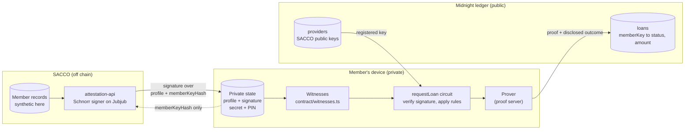
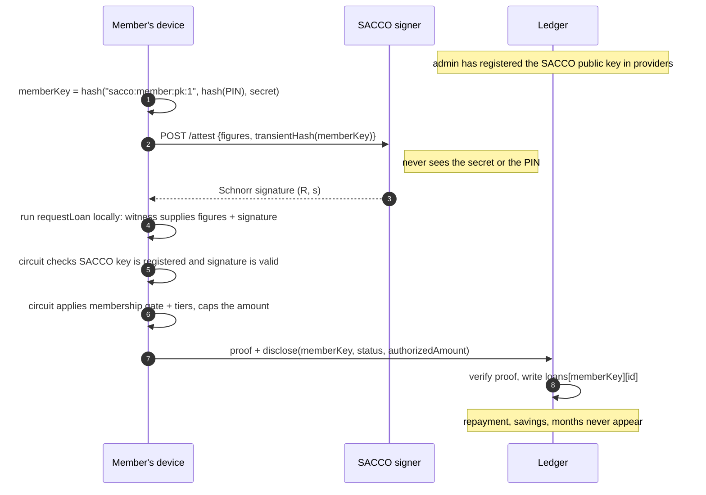

# fairway-credit-gate

**Private member credit for savings cooperatives, on Midnight.**

A member of a savings and credit cooperative (SACCO) proves they qualify for a
loan without revealing their repayment record, savings or length of membership.
The SACCO signs the member's profile off chain. The member's own device checks
that signature and the lending rules inside a zero-knowledge proof. The public
ledger records only the outcome: `{ status, authorizedAmount }`.

> **Public reference version.** This is a sanitized, standalone version of a
> prototype built at Fairway Oy ([fairway.global](https://fairway.global)), which
> works on privacy-preserving credit with SACCOs in Ethiopia. **All member data
> is synthetic.** No partner, member or company data is in this repository.
> The contract is adapted from the `zk-loan` example in
> [midnightntwrk/midnight-examples](https://github.com/midnightntwrk/midnight-examples)
> (Apache-2.0). See [What came from upstream](#what-came-from-upstream).

```bash
make test   # 78 tests in about 6 seconds (after a one-time npm ci), Node 22 only
make demo   # narrated end-to-end run, synthetic members, no keys or Docker
```

---

## Why

A SACCO lends to its own members, and their savings history is the collateral.
Moving that lending onto shared infrastructure (so other lenders can rely on a
SACCO's assessment) creates a privacy problem: a public ledger is public. If the
chain shows a member's savings or repayment score, the cooperative has published
its members' finances.

This contract splits the problem in three:

| Party | Knows | Does |
|---|---|---|
| **SACCO** | the member's real figures (its own books) | signs `[repayment, savings, months, memberKeyHash]` with a Jubjub Schnorr key |
| **Member's device** | the figures, the SACCO's signature, a 32-byte secret and a PIN | runs the circuit locally and produces the proof |
| **Ledger** | registered SACCO public keys, hashed member keys, loan outcomes | verifies the proof and stores the outcome |

## Architecture



### The flow, step by step



If any check fails, the prover cannot produce a proof, so nothing is submitted.
A tampered profile, a signature issued to someone else, or a signer the admin
never registered all stop on the member's device.

## What stays private, what goes public

| Data | Where it lives | Who can see it |
|---|---|---|
| Repayment score, monthly savings, months of membership | Member's private state | Member (and the SACCO that signed it) |
| SACCO's signature over that profile | Member's private state | Member |
| Member secret and PIN | Member's private state | Member |
| Member key = `hash("sacco:member:pk:1", hash(PIN), secret)` | Ledger | Everyone. Derived from a secret, not from a name or the paying wallet; a new PIN gives a new key |
| Loan outcome `{ status, authorizedAmount }` | Ledger | Everyone |
| Which SACCO signed (provider id) | Disclosed by the proof | Everyone |
| Registered SACCO public keys, admin key hash | Ledger | Everyone |

## Lending rules (checked inside the proof)

| Rule | Condition | Max loan (ETB) |
|---|---|---|
| Membership gate | `monthsAsMember < 6` → **Rejected** | none |
| Tier 1 | repayment ≥ 700, savings ≥ 2,000/month, member ≥ 24 months | 10,000 |
| Tier 2 | repayment ≥ 600, savings ≥ 1,500/month | 7,000 |
| Tier 3 | repayment ≥ 580 | 3,000 |
| Otherwise | | Rejected |

Asking for more than your tier allows records a `Proposed` loan at the tier
maximum. The member accepts (`Approved`) or declines (`NotAccepted`) with
`respondToLoan`.

**Why fixed tier amounts, and not "3 × savings"?** Anything the circuit
discloses is public forever. A limit computed from a private number leaks that
number: if the ledger shows a limit of 4,500 and everyone knows the formula is
3 × savings, savings is 1,500. Fixed tiers reveal only which band a member is
in. [WALKTHROUGH.md](WALKTHROUGH.md#5-why-the-tiers-are-fixed-amounts) goes further.

## Quick start

Requirements: Node 22 and GNU make. The Compact compiler is only needed to
recompile the contract.

```bash
git clone <this repo> && cd fairway-credit-gate
make test    # npm ci on first run, then vitest
make demo
```

<details>
<summary>Real output of <code>make demo</code> (abridged)</summary>

```text
3. Members request loans (synthetic data)

   member-B: good record, asks for more than Tier 2 allows
     on device only : repayment 650, savings 1,800 ETB/month, 14 months, secret + PIN
     SACCO signs    : profile bound to member key 0x053f87b74a…
     requests       : 9,000 ETB
 ✓   ledger records : Proposed, 7,000 ETB
 ✓   accepts offer  : Approved, 7,000 ETB

4. Attempts the circuit refuses (no proof, so no transaction)
 ✗ member-D edits savings 1,200 → 2,600 after signing
      refused: "Invalid attestation signature"
 ✗ member-E replays member-A's signed profile
      refused: "Invalid attestation signature"
 ✗ self-made signer claims to be provider 7
      refused: "Attestation provider not registered"
 ✗ a member tries to register their own signer
      refused: "Only admin can register providers"

5. The public ledger after all of the above
   ledger fields : blacklist, contractAdmin, loans, onGoingPinMigration, providers
   loans         :
     0x45080f15c7…  #1  Approved   8,000 ETB   (member-A)
     0x053f87b74a…  #1  Approved   7,000 ETB   (member-B)
     0x11b1a75f95…  #1  Rejected       0 ETB   (member-C)

 ✓ each loan record holds only: authorizedAmount, status
 ✓ none of the 9 private profile values appear on the ledger
```
</details>

### Recompiling the contract

The `--skip-zk` output of compiler **0.31.1** is committed in
`contract/managed/` so the tests need only Node. CI recompiles it on every push
and fails if the committed copy is stale.

```bash
curl --proto '=https' --tlsv1.2 -LsSf https://github.com/midnightntwrk/compact/releases/latest/download/compact-installer.sh | sh
compact update 0.31.1
make compile            # compact compile --skip-zk ...
make check-generated    # compile, then git diff --exit-code contract/managed
# or call a compactc binary directly:
make compile COMPACTC=/path/to/compactc
```

### Other commands

| Command | What it does |
|---|---|
| `make typecheck` | `tsc --noEmit` over contract glue, signer, tests and demo |
| `make attestation` | SACCO signing service on `:4000` (ephemeral key unless `PROVIDER_SECRET_KEY` is set) |
| `make ci` | compile, drift check, typecheck, test, demo |
| `make monorepo MONOREPO=…` | install into a midnight-examples checkout for the devnet lane |

## Two lanes

| | Simulator lane (this repo, standalone) | Devnet lane (inside midnight-examples) |
|---|---|---|
| Runs | compiled circuits in memory, every assert, no proofs | real proofs, local node + indexer + proof server |
| Needs | Node 22 | Docker, Yarn 4, the monorepo, full `compact compile` |
| Command | `make test`, `make demo` | `make monorepo`, then `yarn env:up && yarn test:local` |
| Tests | 78 | 10 (`onchain/`) |
| Status | run here and in CI | not run for this release (see below) |

### Devnet lane

The devnet suite (`onchain/sacco-credit-gate.onchain.test.ts`) deploys the
contract and calls it with real proofs. Its wallet harness,
`@midnight-ntwrk/example-fast-sync`, is a private workspace package of
midnight-examples and is not on npm, so this lane runs inside a monorepo
checkout:

```bash
git clone https://github.com/midnightntwrk/midnight-examples
make monorepo MONOREPO=$PWD/midnight-examples
cd midnight-examples && corepack enable && yarn install
cd examples/sacco-credit-gate
yarn compile && yarn env:up && yarn wait:dust && yarn test:local && yarn env:down
```

`scripts/into-monorepo.sh` copies the source and swaps in the workspace
manifest from `onchain/monorepo/`. Verified so far: in a copy of the monorepo
the install succeeds, `yarn typecheck` passes, `yarn test:sim` runs the same 78
tests, and `yarn test:local` loads and stops at wallet sync because no devnet
was running. **The 10 devnet tests have not been run against a live devnet for
this release.**

## Tests

| Suite | File | Tests |
|---|---|---|
| Contract on the simulator | `test/sacco-credit-gate.sim.test.ts` | 65 |
| Signing service over HTTP | `test/attestation-api/server.test.ts` | 4 |
| Schnorr signer | `test/attestation-api/signing.test.ts` | 6 |
| Demo scenario | `test/demo.test.ts` | 3 |
| **Standalone total** | | **78** |
| Devnet (monorepo lane, not run here) | `onchain/sacco-credit-gate.onchain.test.ts` | 10 |

The 65 contract tests cover every tier boundary (699/700, 599/600, 579/580),
the membership gate (5 vs 6 months), Proposed/accept/decline, blacklisting,
PIN rotation across several batches, admin rotation, unregistered and removed
providers, tampered and replayed attestations, a forged signature that exploits
an unconstrained Schnorr challenge quotient (regression test for the range
check in `schnorr.compact`), and a check that the ledger holds nothing but
outcomes.

## Repository layout

```text
contract/          Compact source, witnesses, compiled output (managed/)
attestation-api/   the SACCO's signing service: Schnorr signer + HTTP API
test/              simulator harness and the 78 standalone tests
demo/              the scenario behind `make demo`
onchain/           devnet suite and its monorepo manifests
scripts/           into-monorepo.sh
.github/workflows/ CI: Compact 0.31.1 install, compile, drift check, tests, demo
```

[WALKTHROUGH.md](WALKTHROUGH.md) explains each file for someone new to Midnight.
[DEMO.md](DEMO.md) is a three-minute screen-share script.

## What came from upstream

The zero-knowledge machinery is the `zk-loan` example's: the in-circuit
Schnorr verifier, the witness-assisted challenge reduction and its soundness
fix, witness-derived identity, PIN rotation, the attestation API, the
simulator harness and most of the tests.

What this repository changes or adds:

- Domain model for cooperatives: `creditScore → repaymentScore`,
  `monthlyIncome → monthlySavings`, `monthsAsCustomer → monthsAsMember`; the
  attestation provider is the member's SACCO; amounts labelled in ETB.
- A six-month membership gate, evaluated first and privately.
- New domain-separation strings for derived keys (`sacco:member:pk:1`,
  `sacco:admin:pk:v01`).
- Tests for the membership gate and for "nothing but outcomes on the ledger".
- Standalone npm build outside the monorepo, with the compiled output
  committed and checked for drift in CI.
- The narrated demo and its test, the Makefile, the monorepo installer, and
  these docs.

## Honest scope

- **The demo signer trusts its input.** `POST /attest` signs whatever figures
  it receives. A real SACCO signer reads its own books and authenticates the
  member. The contract proves *which* SACCO vouched for the data; it cannot
  prove the SACCO told the truth.
- **Thresholds are compiled in.** Changing a tier means redeploying. A credit
  committee should be able to set policy on the ledger.
- **Bands still leak a little.** An outcome reveals a band, and repeated
  requests over time reveal a trajectory. Acceptable for a pilot; worth a design
  note for production.
- **Amounts are `Uint<16>`**, so no single loan can exceed 65,535 units. A
  production version would widen the type or count in larger units.
- **The simulator skips proving.** It runs the same circuit logic and asserts,
  but proof generation, proof size and proving time are only exercised by the
  devnet lane, which was not run for this release.
- **One SACCO in the demo.** The contract supports several registered
  providers (there is a test for two); per-SACCO policy is not implemented.
- **No browser UI** and no wallet integration in this repository.
- **No LLM calls.** Nothing here sends member data to a model.

## License

Apache-2.0. See [LICENSE](LICENSE) and [NOTICE](NOTICE). Derived from
[midnightntwrk/midnight-examples](https://github.com/midnightntwrk/midnight-examples),
Copyright (C) Midnight Foundation.
